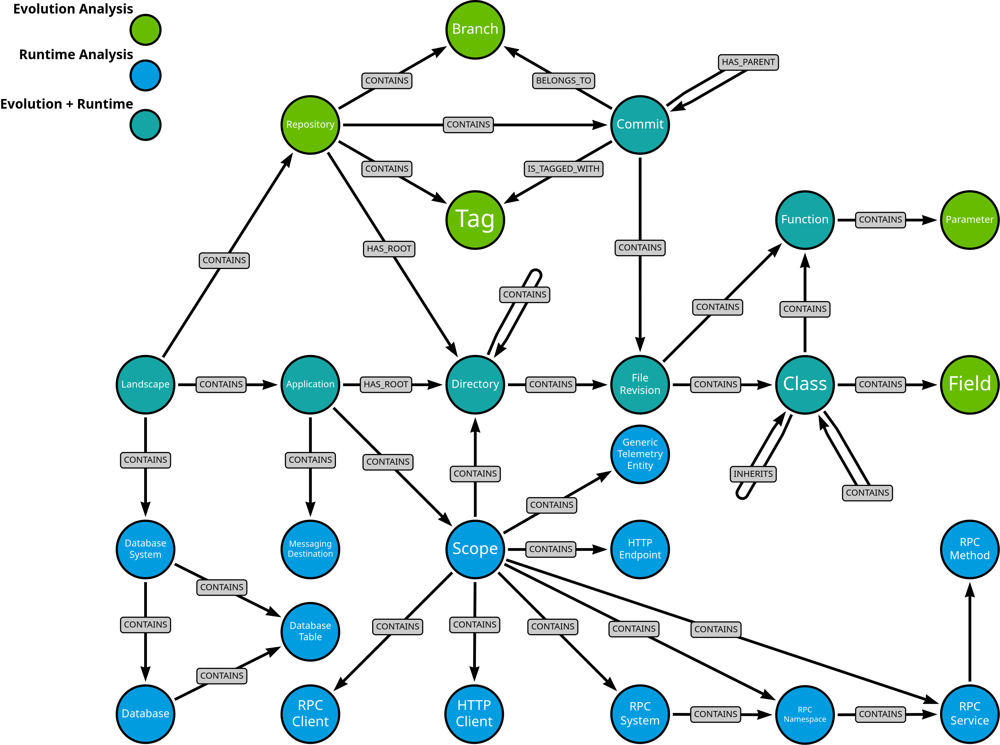

# landscape-service

The landscape-service acts as a database service and stores the runtime and evolution data generated by the [otel-collector](https://github.com/ExplorViz/otel-collector) and the [code-analyzer](https://github.com/ExplorViz/code-analyzer).
This data is made available to the [frontend](https://github.com/ExplorViz/frontend) via a REST API.

All data is persisted in a [graph database](https://en.wikipedia.org/wiki/Graph_database) using [Neo4j](https://neo4j.com/). The database model is shown below.

For the REST API as well as communication via gRPC and Kafka, we use the [Quarkus](https://quarkus.io/guides/getting-started) framework. All interactions with the Neo4j database are performed through the [Neo4j-OGM](https://neo4j.com/docs/ogm-manual/current/introduction/) library by using the corresponding [Quarkus integration](https://github.com/neo4j/neo4j-ogm-quarkus). The landscape-service communicates with the [code-analyzer](https://github.com/ExplorViz/code-analyzer) via gRPC and with the [otel-collector](https://github.com/ExplorViz/otel-collector) via Apache Kafka.

For development instructions, continue reading below. If you just want to run ExplorViz locally, refer to our [Deployment repository](https://github.com/ExplorViz/deployment) instead.

# Table of Contents

- [landscape-service](#landscape-service)
- [Table of Contents](#table-of-contents)
- [Development Instructions](#development-instructions)
  - [Prerequisites](#prerequisites)
  - [Code Style](#code-style)
    - [Formatting](#formatting)
    - [Pre-commit hook](#pre-commit-hook)
  - [Running the application in dev mode](#running-the-application-in-dev-mode)
  - [Packaging and running the application](#packaging-and-running-the-application)
  - [Creating a native executable](#creating-a-native-executable)
  - [Testing](#testing)
- [Database Model](#database-model)
  - [Node Fields](#node-fields)
    - [Application](#application)
    - [Branch](#branch)
    - [Clazz](#clazz)
    - [Commit](#commit)
    - [Directory](#directory)
    - [Field](#field)
    - [FileRevision](#filerevision)
    - [Function](#function)
    - [Landscape](#landscape)
    - [Parameter](#parameter)
    - [Repository](#repository)
    - [Tag](#tag)
  - [Updating the Database Model](#updating-the-database-model)
- [REST-API](#rest-api)
  - [v2](#v2)
    - [GET /v2/landscapes/{landscapeToken}/structure](#get-v2landscapeslandscapetokenstructure)
    - [GET /v2/code/applications/{landscapeToken}](#get-v2codeapplicationslandscapetoken)
    - [GET /v2/code/commit-tree/{landscapeToken}/{applicationName}](#get-v2codecommit-treelandscapetokenapplicationname)
    - [GET /v2/code/metrics/{landscapeToken}/{applicationName}/{commitHash}](#get-v2codemetricslandscapetokenapplicationnamecommithash)
    - [GET /v2/code/structure/{landscapeToken}/{applicationName}/{commitHash}](#get-v2codestructurelandscapetokenapplicationnamecommithash)
    - [GET /v2/code/structure/{landscapeToken}/{applicationName}/{firstCommitHash}-{secondCommitHash}](#get-v2codestructurelandscapetokenapplicationnamefirstcommithash-secondcommithash)
    - [GET /v2/code/commit-comparison/{landscapeToken}/{applicationName}/{firstCommitHash}-{secondCommitHash}](#get-v2codecommit-comparisonlandscapetokenapplicationnamefirstcommithash-secondcommithash)
  - [v3](#v3)
    - [GET /v3/landscapes/{landscapeToken}/structure/runtime](#get-v3landscapeslandscapetokenstructureruntime)
    - [GET /v3/landscapes/{landscapeToken}/structure/evolution/{repositoryName}/{commitHash}](#get-v3landscapeslandscapetokenstructureevolutionrepositorynamecommithash)
    - [GET /v3/landscapes/{landscapeToken}/structure/evolution/{repositoryName}/{firstCommitHash}-{secondCommitHash}](#get-v3landscapeslandscapetokenstructureevolutionrepositorynamefirstcommithash-secondcommithash)
    - [POST /v3/landscapes/{landscapeToken}/structure/evolution/batch](#post-v3landscapeslandscapetokenstructureevolutionbatch)
    - [GET /v3/landscapes/{landscapeToken}/repositories](#get-v3landscapeslandscapetokenrepositories)
    - [GET /v3/landscapes/{landscapeToken}/commit-tree/{repositoryName}](#get-v3landscapeslandscapetokencommit-treerepositoryname)

# Development Instructions

## Prerequisites

- **Java**: JDK 21
- **Build**: Use the included Gradle 9.7 wrapper (`./gradlew`); Quarkus 3.40.1.1 LTS manages the platform dependencies
- **Docker**: Installed and running, since the landscape-service starts its own Docker container in dev mode and when running tests

## Code Style

### Formatting

We recommend using the [IntelliJ IDEA IDE](https://www.jetbrains.com/idea/). Your code should follow the [Google Java Style Guide](https://google.github.io/styleguide/javaguide.html). This is enforced using [Spotless](https://github.com/diffplug/spotless) as part of a pre-commit hook. Before committing, run `./gradlew spotlessApply` to automatically fix any formatting issues.

To integrate this format with IntelliJ's formatter (`Ctrl + Alt + L` shortcut), we recommend the  official [google-java-format](https://plugins.jetbrains.com/plugin/8527-google-java-format) plugin. Carefully follow [these](https://github.com/google/google-java-format/blob/master/README.md#intellij-android-studio-and-other-jetbrains-ides) instructions to install it. Alternatively, you can use one of the plugins for the [Spotless IDE hook](https://github.com/diffplug/spotless/blob/main/plugin-gradle/IDE_HOOK.md). This hook also integrates with Visual Studio Code.

### Pre-commit hook

As part of a git pre-commit hook, your code is checked using [Spotless](https://github.com/diffplug/spotless), [Checkstyle](https://checkstyle.sourceforge.io/) and [PMD](https://pmd.github.io/). If any of these checks fails, the commit is blocked until the issues are resolved. Additionally, all tests must pass for the commit to be successful. Please ensure that all issues are adequately resolved before commiting your changes. If absolutely required, you can skip the pre-commit hook validation using the `--no-verify` flag, but ensure the issues are addressed before creating a merge request.

## Running the application in dev mode

You can run your application in dev mode that enables live reloading using:

```shell script
./gradlew quarkusDev
```

When starting the landscape-service in dev mode, a Neo4j Docker container is automatically started as part of Quarkus's [Dev Services](https://docs.quarkiverse.io/quarkus-neo4j/dev/index.html#dev-services). If an existing Neo4j container is reachable via the default URI (http://localhost:7687), e.g. when running Neo4j as part of the [Docker deployment](https://git.se.informatik.uni-kiel.de/ExplorViz/code/deployment/-/tree/main/docker) or via the Docker compose included in this repository's `.dev` folder, then that instance is used instead.

An overview of the available endpoints is provided in the Quarkus Dev UI at http://localhost:8085/q/dev/. If you are only concerned with providing data to the frontend, you can use the dev-exclusive `/example` endpoints to populate the database with example data.

You can also inspect and manipulate the current state of the database using [Neo4j Browser](https://neo4j.com/docs/browser/). By default, the browser runs on http://localhost:7474.

## Testing

To ensure the landscape-service is working properly, there are a number of tests that can be executed using the following command:

```
./gradlew quarkusTest
```

The tests are also run as part of the git pre-commit hook.

# Database Model



## Node Fields

### Application

| Field  |   Type   |
|--------|----------|
| **id** | **Long** |
| name   | String   |

### Branch

| Field  |   Type   |
|--------|----------|
| **id** | **Long** |
| name   | String   |

### Clazz

|         Field         |           Type            |
|-----------------------|---------------------------|
| **id**                | **Long**                  |
| name                  | String                    |
| type                  | ClassType                 |
| modifiers             | Set&lt;String&gt;         |
| implementedInterfaces | Set&lt;String&gt;         |
| annotations           | Set&lt;String&gt;         |
| enumValues            | Set&lt;String&gt;         |
| metrics               | Map&lt;String, Double&gt; |

### Commit

|   Field    |   Type   |
|------------|----------|
| **id**     | **Long** |
| hash       | String   |
| author     | String   |
| authorDate | Instant  |
| commitDate | Instant  |

### Directory

| Field  |   Type   |
|--------|----------|
| **id** | **Long** |
| name   | String   |

### Field

|   Field   |        Type        |
|-----------|--------------------|
| **id**    | **Long**           |
| name      | String             |
| type      | String             |
| modifiers | List&lt;String&gt; |

### FileRevision

|     Field     |           Type            |
|---------------|---------------------------|
| **id**        | **Long**                  |
| name          | String                    |
| hash          | String                    |
| telemetryKey  | String                    |
| hasFileData   | boolean                   |
| language      | Language                  |
| packageName   | String                    |
| importNames   | Set&lt;String&gt;         |
| lastEditor    | String                    |
| addedLines    | int                       |
| modifiedLines | int                       |
| deletedLines  | int                       |
| metrics       | Map&lt;String, Double&gt; |

### Function

|        Field        |           Type            |
|---------------------|---------------------------|
| **id**              | **Long**                  |
| name                | String                    |
| telemetryKey        | String                    |
| returnType          | String                    |
| constructor         | boolean                   |
| annotations         | Set&lt;String&gt;         |
| modifiers           | Set&lt;String&gt;         |
| outgoingMethodCalls | Set&lt;String&gt;         |
| startLine           | int                       |
| endLine             | int                       |
| metrics             | Map&lt;String, Double&gt; |

### Landscape

|    Field    |    Type    |
|-------------|------------|
| **tokenId** | **String** |

### Parameter

|   Field   |        Type        |
|-----------|--------------------|
| **id**    | **Long**           |
| name      | String             |
| type      | String             |
| modifiers | List&lt;String&gt; |

### Repository

| Field  |   Type   |
|--------|----------|
| **id** | **Long** |
| name   | String   |

### Tag

| Field  |   Type   |
|--------|----------|
| **id** | **Long** |
| name   | String   |

## Updating the Database Model

The database model was created using the web application [arrows.app](https://arrows.app/).
It is free to use and is officially recommended by Neo4j.

The model can be exported in formats such as PNG and JSON.
The latest versions can be found under `./resources/`.
You can import the model via JSON or create a resource link that loads the entire model.

[**Link to the model**](https://arrows.app/#/import/json=eyJncmFwaCI6eyJzdHlsZSI6eyJmb250LWZhbWlseSI6InNhbnMtc2VyaWYiLCJiYWNrZ3JvdW5kLWNvbG9yIjoiI2ZmZmZmZiIsImJhY2tncm91bmQtaW1hZ2UiOiIiLCJiYWNrZ3JvdW5kLXNpemUiOiIxMDAlIiwibm9kZS1jb2xvciI6IiNmZmZmZmYiLCJib3JkZXItd2lkdGgiOjQsImJvcmRlci1jb2xvciI6IiMwMDAwMDAiLCJyYWRpdXMiOjUwLCJub2RlLXBhZGRpbmciOjUsIm5vZGUtbWFyZ2luIjoyLCJvdXRzaWRlLXBvc2l0aW9uIjoiYXV0byIsIm5vZGUtaWNvbi1pbWFnZSI6IiIsIm5vZGUtYmFja2dyb3VuZC1pbWFnZSI6IiIsImljb24tcG9zaXRpb24iOiJpbnNpZGUiLCJpY29uLXNpemUiOjY0LCJjYXB0aW9uLXBvc2l0aW9uIjoiaW5zaWRlIiwiY2FwdGlvbi1tYXgtd2lkdGgiOjIwMCwiY2FwdGlvbi1jb2xvciI6IiMwMDAwMDAiLCJjYXB0aW9uLWZvbnQtc2l6ZSI6NTAsImNhcHRpb24tZm9udC13ZWlnaHQiOiJub3JtYWwiLCJsYWJlbC1wb3NpdGlvbiI6Imluc2lkZSIsImxhYmVsLWRpc3BsYXkiOiJwaWxsIiwibGFiZWwtY29sb3IiOiIjMDAwMDAwIiwibGFiZWwtYmFja2dyb3VuZC1jb2xvciI6IiNmZmZmZmYiLCJsYWJlbC1ib3JkZXItY29sb3IiOiIjMDAwMDAwIiwibGFiZWwtYm9yZGVyLXdpZHRoIjo0LCJsYWJlbC1mb250LXNpemUiOjQwLCJsYWJlbC1wYWRkaW5nIjo1LCJsYWJlbC1tYXJnaW4iOjQsImRpcmVjdGlvbmFsaXR5IjoiZGlyZWN0ZWQiLCJkZXRhaWwtcG9zaXRpb24iOiJpbmxpbmUiLCJkZXRhaWwtb3JpZW50YXRpb24iOiJwYXJhbGxlbCIsImFycm93LXdpZHRoIjo1LCJhcnJvdy1jb2xvciI6IiMwMDAwMDAiLCJtYXJnaW4tc3RhcnQiOjUsIm1hcmdpbi1lbmQiOjUsIm1hcmdpbi1wZWVyIjoyMCwiYXR0YWNobWVudC1zdGFydCI6Im5vcm1hbCIsImF0dGFjaG1lbnQtZW5kIjoibm9ybWFsIiwicmVsYXRpb25zaGlwLWljb24taW1hZ2UiOiIiLCJ0eXBlLWNvbG9yIjoiIzAwMDAwMCIsInR5cGUtYmFja2dyb3VuZC1jb2xvciI6IiNmZmZmZmYiLCJ0eXBlLWJvcmRlci1jb2xvciI6IiMwMDAwMDAiLCJ0eXBlLWJvcmRlci13aWR0aCI6MCwidHlwZS1mb250LXNpemUiOjE2LCJ0eXBlLXBhZGRpbmciOjUsInByb3BlcnR5LXBvc2l0aW9uIjoib3V0c2lkZSIsInByb3BlcnR5LWFsaWdubWVudCI6ImNvbG9uIiwicHJvcGVydHktY29sb3IiOiIjMDAwMDAwIiwicHJvcGVydHktZm9udC1zaXplIjoxNiwicHJvcGVydHktZm9udC13ZWlnaHQiOiJub3JtYWwifSwibm9kZXMiOlt7ImlkIjoibjAiLCJwb3NpdGlvbiI6eyJ4IjoxMy4xNzA0NzcwOTU2MzU1MzUsInkiOjQwMC40NDc2NjczMDk4MTY1NX0sImNhcHRpb24iOiJMYW5kc2NhcGUiLCJsYWJlbHMiOltdLCJwcm9wZXJ0aWVzIjp7fSwic3R5bGUiOnsibGFiZWwtZGlzcGxheSI6ImJhcmUiLCJub2RlLWNvbG9yIjoiIzE2YTVhNSIsImxhYmVsLWNvbG9yIjoiI2ZmZmZmZiIsImNhcHRpb24tY29sb3IiOiIjZmZmZmZmIn19LHsiaWQiOiJuMSIsInBvc2l0aW9uIjp7IngiOjYwOS4wMTI4MjQ1Mjk4ODk0LCJ5Ijo0MDAuNDQ0NjcyNTk3MjA5ODN9LCJjYXB0aW9uIjoiRGlyZWN0b3J5IiwibGFiZWxzIjpbXSwicHJvcGVydGllcyI6e30sInN0eWxlIjp7Im5vZGUtY29sb3IiOiIjMTZhNWE1IiwibGFiZWwtZGlzcGxheSI6ImJhcmUiLCJsYWJlbC1jb2xvciI6IiNmZmZmZmYiLCJjYXB0aW9uLWNvbG9yIjoiI2ZmZmZmZiJ9fSx7ImlkIjoibjQiLCJwb3NpdGlvbiI6eyJ4Ijo5MDYuOTIxMDcwMzgwNjkzOSwieSI6LTY5LjQ4MTA4MzUwODkzMzh9LCJjYXB0aW9uIjoiQ29tbWl0IiwibGFiZWxzIjpbXSwicHJvcGVydGllcyI6e30sInN0eWxlIjp7ImxhYmVsLWZvbnQtc2l6ZSI6MjQsIm5vZGUtY29sb3IiOiIjMTZhNWE1IiwibGFiZWwtZGlzcGxheSI6ImJhcmUiLCJsYWJlbC1jb2xvciI6IiNmZmZmZmYiLCJjYXB0aW9uLWNvbG9yIjoiI2ZmZmZmZiJ9fSx7ImlkIjoibjUiLCJwb3NpdGlvbiI6eyJ4Ijo5MDYuOTMyNTAwOTA1NzY0MywieSI6NDAwLjQ0NDY4Nzg1NTk5OTF9LCJjYXB0aW9uIjoiRmlsZSBSZXZpc2lvbiIsImxhYmVscyI6W10sInByb3BlcnRpZXMiOnt9LCJzdHlsZSI6eyJsYWJlbC1mb250LXNpemUiOjI0LCJub2RlLWNvbG9yIjoiIzE2YTVhNSIsImxhYmVsLWRpc3BsYXkiOiJiYXJlIiwibGFiZWwtY29sb3IiOiIjZmZmZmZmIiwiY2FwdGlvbi1mb250LXNpemUiOjE5LCJjYXB0aW9uLWNvbG9yIjoiI2ZmZmZmZiJ9fSx7ImlkIjoibjYiLCJwb3NpdGlvbiI6eyJ4IjoxMjA0Ljg1MjEzOTEzNDgxNCwieSI6MTAyLjY3NTc3NDE1MTg0ODY5fSwiY2FwdGlvbiI6IkZ1bmN0aW9uIiwibGFiZWxzIjpbXSwicHJvcGVydGllcyI6e30sInN0eWxlIjp7Im5vZGUtY29sb3IiOiIjMTZhNWE1IiwibGFiZWwtZGlzcGxheSI6ImJhcmUiLCJsYWJlbC1jb2xvciI6IiNmZmZmZmYiLCJjYXB0aW9uLWNvbG9yIjoiI2ZmZmZmZiJ9fSx7ImlkIjoibjciLCJwb3NpdGlvbiI6eyJ4IjoxMjA0Ljg1MjEzOTEzNDgxNCwieSI6NDAwLjU5NTQ1MDUwNjUzOTd9LCJjYXB0aW9uIjoiQ2xhc3MiLCJsYWJlbHMiOltdLCJwcm9wZXJ0aWVzIjp7fSwic3R5bGUiOnsibm9kZS1jb2xvciI6IiMxNmE1YTUiLCJsYWJlbC1kaXNwbGF5IjoiYmFyZSIsImxhYmVsLWNvbG9yIjoiI2ZmZmZmZiIsImNhcHRpb24tY29sb3IiOiIjZmZmZmZmIn19LHsiaWQiOiJuOCIsInBvc2l0aW9uIjp7IngiOjYwOS4wMDcxMDkzODQ1OTIxLCJ5IjotMjQxLjQ4MTc4OTA4NTM4MDgzfSwiY2FwdGlvbiI6IkJyYW5jaCIsImxhYmVscyI6W10sInByb3BlcnRpZXMiOnt9LCJzdHlsZSI6eyJsYWJlbC1kaXNwbGF5IjoiYmFyZSIsIm5vZGUtY29sb3IiOiIjNjhiYzAwIiwibGFiZWwtY29sb3IiOiIjZmZmZmZmIiwiY2FwdGlvbi1jb2xvciI6IiNmZmZmZmYifX0seyJpZCI6Im45IiwicG9zaXRpb24iOnsieCI6MzExLjA5MzE0ODM4ODQ5MDQsInkiOi02OS40ODEwODM1MDg5MzM4fSwiY2FwdGlvbiI6IlJlcG9zaXRvcnkiLCJsYWJlbHMiOltdLCJwcm9wZXJ0aWVzIjp7fSwic3R5bGUiOnsibGFiZWwtZGlzcGxheSI6ImJhcmUiLCJub2RlLWNvbG9yIjoiIzY4YmMwMCIsImxhYmVsLWNvbG9yIjoiI2ZmZmZmZiIsImNhcHRpb24tY29sb3IiOiIjZmZmZmZmIn19LHsiaWQiOiJuMTAiLCJwb3NpdGlvbiI6eyJ4IjozMTEuMDkzMTQ4MTU0MDE0NDQsInkiOjQwMC40NDQ2NTczMzg0MjA1NH0sImNhcHRpb24iOiJBcHBsaWNhdGlvbiIsImxhYmVscyI6W10sInByb3BlcnRpZXMiOnt9LCJzdHlsZSI6eyJub2RlLWNvbG9yIjoiIzE2YTVhNSIsImxhYmVsLWRpc3BsYXkiOiJiYXJlIiwibGFiZWwtY29sb3IiOiIjZmZmZmZmIiwiY2FwdGlvbi1jb2xvciI6IiNmZmZmZmYifX0seyJpZCI6Im4xMSIsInBvc2l0aW9uIjp7IngiOjE1MDIuNzcxNzc3MzYzODY5NCwieSI6NDAwLjU5NTcyNjY2MTk4MTEzfSwiY2FwdGlvbiI6IkZpZWxkIiwibGFiZWxzIjpbXSwicHJvcGVydGllcyI6e30sInN0eWxlIjp7ImxhYmVsLWRpc3BsYXkiOiJiYXJlIiwibm9kZS1jb2xvciI6IiM2OGJjMDAiLCJsYWJlbC1jb2xvciI6IiNmZmZmZmYiLCJjYXB0aW9uLWNvbG9yIjoiI2ZmZmZmZiJ9fSx7ImlkIjoibjEyIiwicG9zaXRpb24iOnsieCI6MTUwMi43NzE3NzczNjM4Njk0LCJ5IjoxMDIuNTI1MDUzMzc1MDA1OX0sImNhcHRpb24iOiJQYXJhbWV0ZXIiLCJsYWJlbHMiOltdLCJwcm9wZXJ0aWVzIjp7fSwic3R5bGUiOnsibGFiZWwtZGlzcGxheSI6ImJhcmUiLCJub2RlLWNvbG9yIjoiIzY4YmMwMCIsImxhYmVsLWNvbG9yIjoiI2ZmZmZmZiIsImNhcHRpb24tY29sb3IiOiIjZmZmZmZmIn19LHsiaWQiOiJuMTMiLCJwb3NpdGlvbiI6eyJ4Ijo2MDkuMDA3MTA5Mzg0NTkyMSwieSI6MTAyLjUxOTYyMjA2NzUxMzE4fSwiY2FwdGlvbiI6IlRhZyIsImxhYmVscyI6W10sInByb3BlcnRpZXMiOnt9LCJzdHlsZSI6eyJsYWJlbC1kaXNwbGF5IjoiYmFyZSIsIm5vZGUtY29sb3IiOiIjNjhiYzAwIiwibGFiZWwtY29sb3IiOiIjZmZmZmZmIiwiY2FwdGlvbi1jb2xvciI6IiNmZmZmZmYifX0seyJpZCI6Im4xNCIsInBvc2l0aW9uIjp7IngiOjEzLjE2NDc2MTk1MjA2NDg3OSwieSI6Njk4LjM3MDMzODMyODU4Mjl9LCJjYXB0aW9uIjoiRGF0YWJhc2UgU3lzdGVtIiwibGFiZWxzIjpbXSwicHJvcGVydGllcyI6e30sInN0eWxlIjp7Im5vZGUtY29sb3IiOiIjMDA5Y2UwIiwibGFiZWwtZGlzcGxheSI6ImJhcmUiLCJsYWJlbC1jb2xvciI6IiNmZmZmZmYiLCJjYXB0aW9uLWZvbnQtc2l6ZSI6MTcsImNhcHRpb24tY29sb3IiOiIjZmZmZmZmIn19LHsiaWQiOiJuMTUiLCJwb3NpdGlvbiI6eyJ4IjoxMy4xNjc0ODI0ODc0MDcxOCwieSI6OTk2LjI5MzAwOTUwOTE3MzR9LCJjYXB0aW9uIjoiRGF0YWJhc2UiLCJsYWJlbHMiOltdLCJwcm9wZXJ0aWVzIjp7fSwic3R5bGUiOnsibm9kZS1jb2xvciI6IiMwMDljZTAiLCJsYWJlbC1kaXNwbGF5IjoiYmFyZSIsImxhYmVsLWNvbG9yIjoiI2ZmZmZmZiIsImNhcHRpb24tY29sb3IiOiIjZmZmZmZmIn19LHsiaWQiOiJuMTYiLCJwb3NpdGlvbiI6eyJ4IjozMTEuMDkzMTQ4Mzg4NDkwNCwieSI6ODQ3LjMyODk1MzM0Mzc2NzR9LCJjYXB0aW9uIjoiRGF0YWJhc2UgVGFibGUiLCJsYWJlbHMiOltdLCJwcm9wZXJ0aWVzIjp7fSwic3R5bGUiOnsibm9kZS1jb2xvciI6IiMwMDljZTAiLCJsYWJlbC1kaXNwbGF5IjoiYmFyZSIsImxhYmVsLWNvbG9yIjoiI2ZmZmZmZiIsImNhcHRpb24tZm9udC1zaXplIjoxNywiY2FwdGlvbi1jb2xvciI6IiNmZmZmZmYifX0seyJpZCI6Im4xNyIsInBvc2l0aW9uIjp7IngiOjYwOS4wMDcxMDkzODQ1OTIxLCJ5Ijo2OTguMzcwMzM4MzI4NTgyOX0sImNhcHRpb24iOiJTY29wZSIsImxhYmVscyI6W10sInByb3BlcnRpZXMiOnt9LCJzdHlsZSI6eyJub2RlLWNvbG9yIjoiIzAwOWNlMCIsImxhYmVsLWRpc3BsYXkiOiJiYXJlIiwibGFiZWwtY29sb3IiOiIjZmZmZmZmIiwiY2FwdGlvbi1jb2xvciI6IiNmZmZmZmYifX0seyJpZCI6Im4xOCIsInBvc2l0aW9uIjp7IngiOjkwNi45MjEwNzAzODA2OTM5LCJ5Ijo5OTYuMjk2MDE5NTUzMjIxMX0sImNhcHRpb24iOiJSUEMgU3lzdGVtIiwibGFiZWxzIjpbXSwicHJvcGVydGllcyI6e30sInN0eWxlIjp7Im5vZGUtY29sb3IiOiIjMDA5Y2UwIiwibGFiZWwtZGlzcGxheSI6ImJhcmUiLCJsYWJlbC1jb2xvciI6IiNmZmZmZmYiLCJjYXB0aW9uLXBvc2l0aW9uIjoiaW5zaWRlIiwiY2FwdGlvbi1mb250LXdlaWdodCI6Im5vcm1hbCIsImNhcHRpb24tZm9udC1zaXplIjoyMSwiY2FwdGlvbi1jb2xvciI6IiNmZmZmZmYifX0seyJpZCI6Im4xOSIsInBvc2l0aW9uIjp7IngiOjE1MDIuNzcxNzc3MzYzODY5NCwieSI6OTk2LjI5MzAwOTUwOTE3MzR9LCJjYXB0aW9uIjoiUlBDIFNlcnZpY2UiLCJsYWJlbHMiOltdLCJwcm9wZXJ0aWVzIjp7fSwic3R5bGUiOnsibm9kZS1jb2xvciI6IiMwMDljZTAiLCJsYWJlbC1kaXNwbGF5IjoiYmFyZSIsImxhYmVsLWNvbG9yIjoiI2ZmZmZmZiIsImNhcHRpb24tZm9udC1zaXplIjoyMSwiY2FwdGlvbi1jb2xvciI6IiNmZmZmZmYifX0seyJpZCI6Im4yMCIsInBvc2l0aW9uIjp7IngiOjEyMDQuODUyMTM5MTM0ODE0LCJ5Ijo5OTcuNjM3MzE2MzM5MDM0N30sImNhcHRpb24iOiJSUEMgTmFtZXNwYWNlIiwibGFiZWxzIjpbXSwicHJvcGVydGllcyI6e30sInN0eWxlIjp7Im5vZGUtY29sb3IiOiIjMDA5Y2UwIiwibGFiZWwtZGlzcGxheSI6ImJhcmUiLCJsYWJlbC1jb2xvciI6IiNmZmZmZmYiLCJjYXB0aW9uLWZvbnQtc2l6ZSI6MTQsImNhcHRpb24tY29sb3IiOiIjZmZmZmZmIn19LHsiaWQiOiJuMjEiLCJwb3NpdGlvbiI6eyJ4IjozMTEuMDg1OTM1NjY4MzI4NTUsInkiOjk5Ni4yODg4MDY5NDIxNzg2fSwiY2FwdGlvbiI6IlJQQyBDbGllbnQiLCJsYWJlbHMiOltdLCJwcm9wZXJ0aWVzIjp7fSwic3R5bGUiOnsibm9kZS1jb2xvciI6IiMwMDljZTAiLCJsYWJlbC1kaXNwbGF5IjoiYmFyZSIsImxhYmVsLWNvbG9yIjoiI2ZmZmZmZiIsImNhcHRpb24tY29sb3IiOiIjZmZmZmZmIn19LHsiaWQiOiJuMjIiLCJwb3NpdGlvbiI6eyJ4IjozMTEuMDg1OTM1NjY4MzI4NTUsInkiOjY5OC4zNzAzMzgzMjg1ODI5fSwiY2FwdGlvbiI6Ik1lc3NhZ2luZyBEZXN0aW5hdGlvbiIsImxhYmVscyI6W10sInByb3BlcnRpZXMiOnt9LCJzdHlsZSI6eyJub2RlLWNvbG9yIjoiIzAwOWNlMCIsImxhYmVsLWNvbG9yIjoiI2ZmZmZmZiIsImxhYmVsLWRpc3BsYXkiOiJiYXJlIiwiY2FwdGlvbi1jb2xvciI6IiNmZmZmZmYifX0seyJpZCI6Im4yMyIsInBvc2l0aW9uIjp7IngiOjE1MDIuNzcxODUzNDIzMDM4NSwieSI6Njk4LjM3MDMzODMyODU4Mjl9LCJjYXB0aW9uIjoiUlBDIE1ldGhvZCIsImxhYmVscyI6W10sInByb3BlcnRpZXMiOnt9LCJzdHlsZSI6eyJub2RlLWNvbG9yIjoiIzAwOWNlMCIsImxhYmVsLWNvbG9yIjoiI2ZmZmZmZiIsImxhYmVsLWRpc3BsYXkiOiJiYXJlIiwiY2FwdGlvbi1mb250LXNpemUiOjIwLCJjYXB0aW9uLWNvbG9yIjoiI2ZmZmZmZiJ9fSx7ImlkIjoibjI0IiwicG9zaXRpb24iOnsieCI6OTA2LjkzMjUwMDkwNTc2NDMsInkiOjUyNi4zNjMwMzMzMzU0MDk1fSwiY2FwdGlvbiI6IkdlbmVyaWMgVGVsZW1ldHJ5IEVudGl0eSIsImxhYmVscyI6W10sInByb3BlcnRpZXMiOnt9LCJzdHlsZSI6eyJub2RlLWNvbG9yIjoiIzAwOWNlMCIsImxhYmVsLWNvbG9yIjoiI2ZmZmZmZiIsImxhYmVsLWRpc3BsYXkiOiJiYXJlIiwiY2FwdGlvbi1jb2xvciI6IiNmZmZmZmYifX0seyJpZCI6Im4yNSIsInBvc2l0aW9uIjp7IngiOjkwNi45MzI1MDA5MDU3NjQzLCJ5Ijo2OTguMzcwMzM4MzI4NTgyOX0sImNhcHRpb24iOiJIVFRQIEVuZHBvaW50IiwibGFiZWxzIjpbXSwicHJvcGVydGllcyI6e30sInN0eWxlIjp7Im5vZGUtY29sb3IiOiIjMDA5Y2UwIiwibGFiZWwtY29sb3IiOiIjZmZmZmZmIiwibGFiZWwtZGlzcGxheSI6ImJhcmUiLCJjYXB0aW9uLWZvbnQtc2l6ZSI6MTgsImNhcHRpb24tY29sb3IiOiIjZmZmZmZmIn19LHsiaWQiOiJuMjYiLCJwb3NpdGlvbiI6eyJ4Ijo2MDYuOTc2MTA2NjgzMDI2MywieSI6OTk2LjI4ODgwNjk0MjE3ODZ9LCJjYXB0aW9uIjoiSFRUUCBDbGllbnQiLCJsYWJlbHMiOltdLCJwcm9wZXJ0aWVzIjp7fSwic3R5bGUiOnsibm9kZS1jb2xvciI6IiMwMDljZTAiLCJsYWJlbC1jb2xvciI6IiNmZmZmZmYiLCJsYWJlbC1kaXNwbGF5IjoiYmFyZSIsImNhcHRpb24tY29sb3IiOiIjZmZmZmZmIn19LHsiaWQiOiJuMjciLCJwb3NpdGlvbiI6eyJ4IjoxMy4xNzA0NzcwOTU2MzU1MzMsInkiOi0xNTguOTkwNjU4NjIwMTkxfSwiY2FwdGlvbiI6IlJ1bnRpbWUgQW5hbHlzaXMiLCJsYWJlbHMiOltdLCJwcm9wZXJ0aWVzIjp7fSwic3R5bGUiOnsibm9kZS1jb2xvciI6IiMwMDljZTAiLCJsYWJlbC1jb2xvciI6IiNmZmZmZmYiLCJsYWJlbC1kaXNwbGF5IjoiYmFyZSIsInJhZGl1cyI6MjUsImNhcHRpb24tcG9zaXRpb24iOiJvdXRzaWRlIiwiY2FwdGlvbi1mb250LXNpemUiOjI0LCJjYXB0aW9uLW1heC13aWR0aCI6MjIwLCJjYXB0aW9uLWZvbnQtd2VpZ2h0IjoiYm9sZCJ9fSx7ImlkIjoibjI4IiwicG9zaXRpb24iOnsieCI6MTMuMTcwNDc3MDk1NjM1NTM1LCJ5IjotMjQxLjQ4MTc4OTA4NTM4MDgzfSwiY2FwdGlvbiI6IkV2b2x1dGlvbiBBbmFseXNpcyIsImxhYmVscyI6W10sInByb3BlcnRpZXMiOnt9LCJzdHlsZSI6eyJsYWJlbC1kaXNwbGF5IjoiYmFyZSIsIm5vZGUtY29sb3IiOiIjNjhiYzAwIiwibGFiZWwtY29sb3IiOiIjZmZmZmZmIiwiY2FwdGlvbi1wb3NpdGlvbiI6Im91dHNpZGUiLCJyYWRpdXMiOjI1LCJjYXB0aW9uLWZvbnQtc2l6ZSI6MjQsImNhcHRpb24tbWF4LXdpZHRoIjoyMjAsImNhcHRpb24tZm9udC13ZWlnaHQiOiJib2xkIn19LHsiaWQiOiJuMjkiLCJwb3NpdGlvbiI6eyJ4IjoxMy4xNzA0NzcwOTU2MzU1MzMsInkiOi02OS40ODEwODM1MDg5MzM4NH0sImNhcHRpb24iOiJFdm9sdXRpb24gKyBSdW50aW1lIiwibGFiZWxzIjpbXSwicHJvcGVydGllcyI6e30sInN0eWxlIjp7Im5vZGUtY29sb3IiOiIjMTZhNWE1IiwibGFiZWwtY29sb3IiOiIjZmZmZmZmIiwibGFiZWwtZGlzcGxheSI6ImJhcmUiLCJyYWRpdXMiOjI1LCJjYXB0aW9uLXBvc2l0aW9uIjoib3V0c2lkZSIsImNhcHRpb24tZm9udC1zaXplIjoyNCwiY2FwdGlvbi1tYXgtd2lkdGgiOjI1MCwiY2FwdGlvbi1mb250LXdlaWdodCI6ImJvbGQifX1dLCJyZWxhdGlvbnNoaXBzIjpbeyJpZCI6Im4yIiwiZnJvbUlkIjoibjUiLCJ0b0lkIjoibjYiLCJ0eXBlIjoiQ09OVEFJTlMiLCJwcm9wZXJ0aWVzIjp7fSwic3R5bGUiOnsiZGV0YWlsLW9yaWVudGF0aW9uIjoiaG9yaXpvbnRhbCIsInR5cGUtYmFja2dyb3VuZC1jb2xvciI6IiNjY2NjY2MiLCJ0eXBlLWJvcmRlci13aWR0aCI6Mn19LHsiaWQiOiJuMyIsImZyb21JZCI6Im40IiwidG9JZCI6Im40IiwidHlwZSI6IkhBU19QQVJFTlQiLCJwcm9wZXJ0aWVzIjp7fSwic3R5bGUiOnsidHlwZS1wYWRkaW5nIjo1LCJtYXJnaW4tcGVlciI6MjAsImRldGFpbC1wb3NpdGlvbiI6ImlubGluZSIsImRldGFpbC1vcmllbnRhdGlvbiI6Imhvcml6b250YWwiLCJ0eXBlLWJhY2tncm91bmQtY29sb3IiOiIjY2NjY2NjIiwidHlwZS1ib3JkZXItd2lkdGgiOjJ9fSx7ImlkIjoibjUiLCJmcm9tSWQiOiJuNyIsInRvSWQiOiJuNiIsInR5cGUiOiJDT05UQUlOUyIsInByb3BlcnRpZXMiOnt9LCJzdHlsZSI6eyJkZXRhaWwtb3JpZW50YXRpb24iOiJob3Jpem9udGFsIiwidHlwZS1iYWNrZ3JvdW5kLWNvbG9yIjoiI2NjY2NjYyIsInR5cGUtYm9yZGVyLXdpZHRoIjoyfX0seyJpZCI6Im42IiwiZnJvbUlkIjoibjciLCJ0b0lkIjoibjciLCJ0eXBlIjoiQ09OVEFJTlMiLCJwcm9wZXJ0aWVzIjp7fSwic3R5bGUiOnsiZGV0YWlsLXBvc2l0aW9uIjoiaW5saW5lIiwiZGV0YWlsLW9yaWVudGF0aW9uIjoiaG9yaXpvbnRhbCIsInR5cGUtYmFja2dyb3VuZC1jb2xvciI6IiNjY2NjY2MiLCJ0eXBlLWJvcmRlci13aWR0aCI6Mn19LHsiaWQiOiJuNyIsImZyb21JZCI6Im43IiwidG9JZCI6Im43IiwidHlwZSI6IklOSEVSSVRTIiwicHJvcGVydGllcyI6e30sInN0eWxlIjp7ImRldGFpbC1wb3NpdGlvbiI6ImFib3ZlIiwidHlwZS1iYWNrZ3JvdW5kLWNvbG9yIjoiI2NjY2NjYyIsInR5cGUtYm9yZGVyLXdpZHRoIjoyLCJkZXRhaWwtb3JpZW50YXRpb24iOiJob3Jpem9udGFsIn19LHsiaWQiOiJuOCIsImZyb21JZCI6Im41IiwidG9JZCI6Im43IiwidHlwZSI6IkNPTlRBSU5TIiwicHJvcGVydGllcyI6e30sInN0eWxlIjp7InR5cGUtYmFja2dyb3VuZC1jb2xvciI6IiNjY2NjY2MiLCJ0eXBlLWJvcmRlci13aWR0aCI6MiwiZGV0YWlsLW9yaWVudGF0aW9uIjoiaG9yaXpvbnRhbCJ9fSx7ImlkIjoibjkiLCJmcm9tSWQiOiJuNCIsInRvSWQiOiJuOCIsInR5cGUiOiJCRUxPTkdTX1RPIiwicHJvcGVydGllcyI6e30sInN0eWxlIjp7ImRldGFpbC1vcmllbnRhdGlvbiI6Imhvcml6b250YWwiLCJ0eXBlLWJhY2tncm91bmQtY29sb3IiOiIjY2NjY2NjIiwidHlwZS1ib3JkZXItd2lkdGgiOjJ9fSx7ImlkIjoibjEwIiwiZnJvbUlkIjoibjkiLCJ0b0lkIjoibjgiLCJ0eXBlIjoiQ09OVEFJTlMiLCJwcm9wZXJ0aWVzIjp7fSwic3R5bGUiOnsiZGV0YWlsLW9yaWVudGF0aW9uIjoiaG9yaXpvbnRhbCIsInR5cGUtYmFja2dyb3VuZC1jb2xvciI6IiNjY2NjY2MiLCJ0eXBlLWJvcmRlci13aWR0aCI6Mn19LHsiaWQiOiJuMTEiLCJmcm9tSWQiOiJuMCIsInRvSWQiOiJuOSIsInR5cGUiOiJDT05UQUlOUyIsInByb3BlcnRpZXMiOnt9LCJzdHlsZSI6eyJ0eXBlLWZvbnQtc2l6ZSI6MTYsImRldGFpbC1vcmllbnRhdGlvbiI6Imhvcml6b250YWwiLCJ0eXBlLWJhY2tncm91bmQtY29sb3IiOiIjY2NjY2NjIiwidHlwZS1ib3JkZXItd2lkdGgiOjJ9fSx7ImlkIjoibjEzIiwiZnJvbUlkIjoibjkiLCJ0b0lkIjoibjQiLCJ0eXBlIjoiQ09OVEFJTlMiLCJwcm9wZXJ0aWVzIjp7fSwic3R5bGUiOnsiZGV0YWlsLW9yaWVudGF0aW9uIjoiaG9yaXpvbnRhbCIsInR5cGUtYmFja2dyb3VuZC1jb2xvciI6IiNjY2NjY2MiLCJ0eXBlLWJvcmRlci13aWR0aCI6Mn19LHsiaWQiOiJuMTQiLCJmcm9tSWQiOiJuMSIsInRvSWQiOiJuNSIsInR5cGUiOiJDT05UQUlOUyIsInByb3BlcnRpZXMiOnt9LCJzdHlsZSI6eyJ0eXBlLWJhY2tncm91bmQtY29sb3IiOiIjY2NjY2NjIiwidHlwZS1ib3JkZXItd2lkdGgiOjJ9fSx7ImlkIjoibjE1IiwiZnJvbUlkIjoibjEiLCJ0b0lkIjoibjEiLCJ0eXBlIjoiQ09OVEFJTlMiLCJwcm9wZXJ0aWVzIjp7fSwic3R5bGUiOnsidHlwZS1mb250LXNpemUiOjE2LCJkZXRhaWwtcG9zaXRpb24iOiJiZWxvdyIsInR5cGUtYmFja2dyb3VuZC1jb2xvciI6IiNjY2NjY2MiLCJ0eXBlLWJvcmRlci13aWR0aCI6MiwiZGV0YWlsLW9yaWVudGF0aW9uIjoiaG9yaXpvbnRhbCJ9fSx7ImlkIjoibjE2IiwiZnJvbUlkIjoibjQiLCJ0b0lkIjoibjUiLCJ0eXBlIjoiQ09OVEFJTlMiLCJwcm9wZXJ0aWVzIjp7fSwic3R5bGUiOnsiZGV0YWlsLW9yaWVudGF0aW9uIjoicGVycGVuZGljdWxhciIsInR5cGUtYmFja2dyb3VuZC1jb2xvciI6IiNjY2NjY2MiLCJ0eXBlLWJvcmRlci13aWR0aCI6Mn19LHsiaWQiOiJuMTciLCJmcm9tSWQiOiJuMTAiLCJ0b0lkIjoibjEiLCJ0eXBlIjoiSEFTX1JPT1QiLCJwcm9wZXJ0aWVzIjp7fSwic3R5bGUiOnsidHlwZS1iYWNrZ3JvdW5kLWNvbG9yIjoiI2NjY2NjYyIsInR5cGUtYm9yZGVyLXdpZHRoIjoyfX0seyJpZCI6Im4xOCIsImZyb21JZCI6Im45IiwidG9JZCI6Im4xIiwidHlwZSI6IkhBU19ST09UIiwicHJvcGVydGllcyI6e30sInN0eWxlIjp7ImRldGFpbC1vcmllbnRhdGlvbiI6Imhvcml6b250YWwiLCJkZXRhaWwtcG9zaXRpb24iOiJpbmxpbmUiLCJ0eXBlLWJhY2tncm91bmQtY29sb3IiOiIjY2NjY2NjIiwidHlwZS1ib3JkZXItd2lkdGgiOjJ9fSx7ImlkIjoibjE5IiwiZnJvbUlkIjoibjciLCJ0b0lkIjoibjExIiwidHlwZSI6IkNPTlRBSU5TIiwicHJvcGVydGllcyI6e30sInN0eWxlIjp7ImRldGFpbC1vcmllbnRhdGlvbiI6Imhvcml6b250YWwiLCJ0eXBlLWJhY2tncm91bmQtY29sb3IiOiIjY2NjY2NjIiwidHlwZS1ib3JkZXItd2lkdGgiOjJ9fSx7ImlkIjoibjIwIiwiZnJvbUlkIjoibjYiLCJ0b0lkIjoibjEyIiwidHlwZSI6IkNPTlRBSU5TIiwicHJvcGVydGllcyI6e30sInN0eWxlIjp7InR5cGUtYmFja2dyb3VuZC1jb2xvciI6IiNjY2NjY2MiLCJ0eXBlLWNvbG9yIjoiIzAwMDAwMCIsImRldGFpbC1wb3NpdGlvbiI6ImlubGluZSIsImRldGFpbC1vcmllbnRhdGlvbiI6Imhvcml6b250YWwiLCJkaXJlY3Rpb25hbGl0eSI6ImRpcmVjdGVkIiwidHlwZS1ib3JkZXItd2lkdGgiOjJ9fSx7ImlkIjoibjIxIiwiZnJvbUlkIjoibjQiLCJ0b0lkIjoibjEzIiwidHlwZSI6IklTX1RBR0dFRF9XSVRIIiwicHJvcGVydGllcyI6e30sInN0eWxlIjp7ImRldGFpbC1vcmllbnRhdGlvbiI6Imhvcml6b250YWwiLCJ0eXBlLWJhY2tncm91bmQtY29sb3IiOiIjY2NjY2NjIiwidHlwZS1ib3JkZXItd2lkdGgiOjJ9fSx7ImlkIjoibjIyIiwiZnJvbUlkIjoibjkiLCJ0b0lkIjoibjEzIiwidHlwZSI6IkNPTlRBSU5TIiwicHJvcGVydGllcyI6e30sInN0eWxlIjp7ImRldGFpbC1vcmllbnRhdGlvbiI6Imhvcml6b250YWwiLCJ0eXBlLWJhY2tncm91bmQtY29sb3IiOiIjY2NjY2NjIiwidHlwZS1ib3JkZXItd2lkdGgiOjJ9fSx7ImlkIjoibjIzIiwiZnJvbUlkIjoibjAiLCJ0b0lkIjoibjEwIiwidHlwZSI6IkNPTlRBSU5TIiwicHJvcGVydGllcyI6e30sInN0eWxlIjp7InR5cGUtYmFja2dyb3VuZC1jb2xvciI6IiNjY2NjY2MiLCJ0eXBlLWJvcmRlci13aWR0aCI6Mn19LHsiaWQiOiJuMjUiLCJmcm9tSWQiOiJuMCIsInRvSWQiOiJuMTQiLCJ0eXBlIjoiQ09OVEFJTlMiLCJwcm9wZXJ0aWVzIjp7fSwic3R5bGUiOnsidHlwZS1iYWNrZ3JvdW5kLWNvbG9yIjoiI2NjY2NjYyIsInR5cGUtYm9yZGVyLXdpZHRoIjoyLCJkZXRhaWwtb3JpZW50YXRpb24iOiJob3Jpem9udGFsIn19LHsiaWQiOiJuMjYiLCJmcm9tSWQiOiJuMTQiLCJ0b0lkIjoibjE2IiwidHlwZSI6IkNPTlRBSU5TIiwicHJvcGVydGllcyI6e30sInN0eWxlIjp7ImRldGFpbC1vcmllbnRhdGlvbiI6Imhvcml6b250YWwiLCJ0eXBlLWNvbG9yIjoiIzAwMDAwMCIsInR5cGUtYm9yZGVyLXdpZHRoIjoyLCJ0eXBlLWJhY2tncm91bmQtY29sb3IiOiIjY2NjY2NjIn19LHsiaWQiOiJuMjciLCJmcm9tSWQiOiJuMTQiLCJ0b0lkIjoibjE1IiwidHlwZSI6IkNPTlRBSU5TIiwicHJvcGVydGllcyI6e30sInN0eWxlIjp7ImRldGFpbC1vcmllbnRhdGlvbiI6Imhvcml6b250YWwiLCJ0eXBlLWJvcmRlci13aWR0aCI6MiwidHlwZS1iYWNrZ3JvdW5kLWNvbG9yIjoiI2NjY2NjYyJ9fSx7ImlkIjoibjI4IiwiZnJvbUlkIjoibjE1IiwidG9JZCI6Im4xNiIsInR5cGUiOiJDT05UQUlOUyIsInByb3BlcnRpZXMiOnt9LCJzdHlsZSI6eyJkZXRhaWwtb3JpZW50YXRpb24iOiJob3Jpem9udGFsIiwidHlwZS1iYWNrZ3JvdW5kLWNvbG9yIjoiI2NjY2NjYyIsInR5cGUtYm9yZGVyLXdpZHRoIjoyfX0seyJpZCI6Im4yOSIsImZyb21JZCI6Im4xMCIsInRvSWQiOiJuMTciLCJ0eXBlIjoiQ09OVEFJTlMiLCJwcm9wZXJ0aWVzIjp7fSwic3R5bGUiOnsiZGV0YWlsLW9yaWVudGF0aW9uIjoiaG9yaXpvbnRhbCIsInR5cGUtYm9yZGVyLXdpZHRoIjoyLCJ0eXBlLWJhY2tncm91bmQtY29sb3IiOiIjY2NjY2NjIn19LHsiaWQiOiJuMzAiLCJmcm9tSWQiOiJuMTciLCJ0b0lkIjoibjEiLCJ0eXBlIjoiQ09OVEFJTlMiLCJwcm9wZXJ0aWVzIjp7fSwic3R5bGUiOnsiZGV0YWlsLW9yaWVudGF0aW9uIjoiaG9yaXpvbnRhbCIsInR5cGUtYmFja2dyb3VuZC1jb2xvciI6IiNjY2NjY2MiLCJ0eXBlLWJvcmRlci13aWR0aCI6Mn19LHsiaWQiOiJuMzEiLCJmcm9tSWQiOiJuMTciLCJ0b0lkIjoibjE4IiwidHlwZSI6IkNPTlRBSU5TIiwicHJvcGVydGllcyI6e30sInN0eWxlIjp7InR5cGUtYm9yZGVyLXdpZHRoIjoyLCJkZXRhaWwtb3JpZW50YXRpb24iOiJob3Jpem9udGFsIiwidHlwZS1iYWNrZ3JvdW5kLWNvbG9yIjoiI2NjY2NjYyJ9fSx7ImlkIjoibjM0IiwiZnJvbUlkIjoibjE3IiwidG9JZCI6Im4yMSIsInR5cGUiOiJDT05UQUlOUyIsInByb3BlcnRpZXMiOnt9LCJzdHlsZSI6eyJkZXRhaWwtb3JpZW50YXRpb24iOiJob3Jpem9udGFsIiwidHlwZS1iYWNrZ3JvdW5kLWNvbG9yIjoiI2NjY2NjYyIsInR5cGUtYm9yZGVyLXdpZHRoIjoyfX0seyJpZCI6Im4zNSIsImZyb21JZCI6Im4xNyIsInRvSWQiOiJuMTkiLCJ0eXBlIjoiQ09OVEFJTlMiLCJwcm9wZXJ0aWVzIjp7fSwic3R5bGUiOnsidHlwZS1iYWNrZ3JvdW5kLWNvbG9yIjoiI2NjY2NjYyIsInR5cGUtYm9yZGVyLXdpZHRoIjoyLCJkZXRhaWwtb3JpZW50YXRpb24iOiJob3Jpem9udGFsIn19LHsiaWQiOiJuMzYiLCJmcm9tSWQiOiJuMTciLCJ0b0lkIjoibjIwIiwidHlwZSI6IkNPTlRBSU5TIiwicHJvcGVydGllcyI6e30sInN0eWxlIjp7ImRldGFpbC1vcmllbnRhdGlvbiI6Imhvcml6b250YWwiLCJ0eXBlLWJhY2tncm91bmQtY29sb3IiOiIjY2NjY2NjIiwidHlwZS1ib3JkZXItd2lkdGgiOjJ9fSx7ImlkIjoibjM3IiwiZnJvbUlkIjoibjIwIiwidG9JZCI6Im4xOSIsInR5cGUiOiJDT05UQUlOUyIsInByb3BlcnRpZXMiOnt9LCJzdHlsZSI6eyJ0eXBlLWJhY2tncm91bmQtY29sb3IiOiIjY2NjY2NjIiwidHlwZS1ib3JkZXItd2lkdGgiOjIsImRldGFpbC1vcmllbnRhdGlvbiI6Imhvcml6b250YWwifX0seyJpZCI6Im4zOCIsImZyb21JZCI6Im4xOCIsInRvSWQiOiJuMjAiLCJ0eXBlIjoiQ09OVEFJTlMiLCJwcm9wZXJ0aWVzIjp7fSwic3R5bGUiOnsiZGV0YWlsLW9yaWVudGF0aW9uIjoiaG9yaXpvbnRhbCIsInR5cGUtYmFja2dyb3VuZC1jb2xvciI6IiNjY2NjY2MiLCJ0eXBlLWJvcmRlci13aWR0aCI6Mn19LHsiaWQiOiJuMzkiLCJmcm9tSWQiOiJuMTkiLCJ0b0lkIjoibjIzIiwidHlwZSI6IiIsInByb3BlcnRpZXMiOnt9LCJzdHlsZSI6e319LHsiaWQiOiJuNDAiLCJmcm9tSWQiOiJuMTciLCJ0b0lkIjoibjI0IiwidHlwZSI6IkNPTlRBSU5TIiwicHJvcGVydGllcyI6e30sInN0eWxlIjp7ImRldGFpbC1vcmllbnRhdGlvbiI6Imhvcml6b250YWwiLCJ0eXBlLWJhY2tncm91bmQtY29sb3IiOiIjY2NjY2NjIiwidHlwZS1ib3JkZXItd2lkdGgiOjJ9fSx7ImlkIjoibjQxIiwiZnJvbUlkIjoibjEwIiwidG9JZCI6Im4yMiIsInR5cGUiOiJDT05UQUlOUyIsInByb3BlcnRpZXMiOnt9LCJzdHlsZSI6eyJkZXRhaWwtb3JpZW50YXRpb24iOiJob3Jpem9udGFsIiwidHlwZS1ib3JkZXItd2lkdGgiOjIsInR5cGUtYmFja2dyb3VuZC1jb2xvciI6IiNjY2NjY2MifX0seyJpZCI6Im40MiIsImZyb21JZCI6Im4xNyIsInRvSWQiOiJuMjYiLCJ0eXBlIjoiQ09OVEFJTlMiLCJwcm9wZXJ0aWVzIjp7fSwic3R5bGUiOnsiZGV0YWlsLW9yaWVudGF0aW9uIjoiaG9yaXpvbnRhbCIsInR5cGUtYmFja2dyb3VuZC1jb2xvciI6IiNjY2NjY2MiLCJ0eXBlLWJvcmRlci13aWR0aCI6Mn19LHsiaWQiOiJuNDMiLCJmcm9tSWQiOiJuMTciLCJ0b0lkIjoibjI1IiwidHlwZSI6IkNPTlRBSU5TIiwicHJvcGVydGllcyI6e30sInN0eWxlIjp7ImRldGFpbC1vcmllbnRhdGlvbiI6Imhvcml6b250YWwiLCJ0eXBlLWJhY2tncm91bmQtY29sb3IiOiIjY2NjY2NjIiwidHlwZS1ib3JkZXItd2lkdGgiOjJ9fV19LCJkaWFncmFtTmFtZSI6Im40aiJ9)

**Please note:**
*After every change to the model, the JSON file at `./resources/db_model.json` must be updated, and the PNG file at `./resources/db_model.png` should also be replaced with a new PNG export.
In addition, the link in this README.md file must be updated to the new link.*

# REST-API

The landscape-service provides a REST-API for the [frontend](https://git.se.informatik.uni-kiel.de/ExplorViz/code/frontend).
There are two versions available.

## v2

Version 2 offers the standard endpoints that were used prior to the switch to the landscape-service.
This can be used to work with older versions of the [frontend](https://git.se.informatik.uni-kiel.de/ExplorViz/code/frontend). For developing new features, please
refer to the version 3 of the API.

### GET /v2/landscapes/{landscapeToken}/structure

```Java
LandscapeDto getStructureData(String landscapeToken);
```

Returns the landscape associated with a landscape token.

### GET /v2/code/applications/{landscapeToken}

```Java
List<String> getStaticApplicationNamesForLandscape(String landscapeToken);
```

Returns the names of all applications in a landscape that are backed by data from git evolution analysis.

### GET /v2/code/commit-tree/{landscapeToken}/{applicationName}

```Java
CommitTreeDto getCommitTreeForApplicationAndLandscape(String landscapeToken, String applicationName);
```

Returns the tree of commits associated with a landscape and an application.

### GET /v2/code/metrics/{landscapeToken}/{applicationName}/{commitHash}

```Java
ApplicationMetricsCodeDto getStaticCodeMetricsForApplicationAndCommit(
        String landscapeToken, String applicationName, String commitHash);
```

Returns the code metrics associated with a landscape, an application, and a commit.

### GET /v2/code/structure/{landscapeToken}/{applicationName}/{commitHash}

```Java
LandscapeDto getStaticStructureForApplicationAndSingleCommit(
        String landscapeToken, String applicationName, String commitHash);
```

Returns the landscape structure associated with a landscape, an application, and a commit.

### GET /v2/code/structure/{landscapeToken}/{applicationName}/{firstCommitHash}-{secondCommitHash}

```Java
LandscapeDto getStaticStructureForApplicationAndTwoCommits(
        String landscapeToken, String applicationName, String firstCommitHash, String secondCommitHash);
```

Returns the union of the landscape structures associated with two commits of an application in a landscape.

### GET /v2/code/commit-comparison/{landscapeToken}/{applicationName}/{firstCommitHash}-{secondCommitHash}

```Java
CommitComparison getCommitComparison(
        String landscapeToken, String applicationName, String firstCommitHash, String secondCommitHash);
```

Returns a comparison object of two commits associated with a landscape and an application.

## v3

Version 3 features a redesign of the endpoints, allowing many of the calculations to be moved from the [frontend](https://git.se.informatik.uni-kiel.de/ExplorViz/code/frontend) to the landscape-service.
The central change is the switch to a flat data model as opposed to a deeply nested one, allowing fast lookups for visualization objects.

Be sure to update this README when implementing new endpoints.

### GET /v3/landscapes/{landscapeToken}/structure/runtime

```Java
FlatLandscapeDto getRuntimeStructureData(String landscapeToken);
```

Returns all landscape structure data gathered from runtime analysis for a landscape.

### GET /v3/landscapes/{landscapeToken}/structure/evolution/{repositoryName}/{commitHash}

```Java
FlatLandscapeDto getStaticStructureData(String landscapeToken, String repositoryName, String commitHash);
```

Retrieve landscape structure data gathered from static analysis for a particular repository and commit in a landscape.

### GET /v3/landscapes/{landscapeToken}/structure/evolution/{repositoryName}/{firstCommitHash}-{secondCommitHash}

```Java
FlatLandscapeDto getCombinedStaticStructureData(String landscapeToken, String repositoryName, String firstCommitHash, String secondCommitHash);
```

Retrieve the union of landscape structure data for the two provided commits within the given landscape and repository.
The value for the `commitComparison` attribute is set relative to the second commit, e.g. "DELETED" is written if some component is present in the first commit, but not the second.

### POST /v3/landscapes/{landscapeToken}/structure/evolution/batch

```Java
FlatLandscapeDto postEvolutionStructureBatch(
    String landscapeToken,
    EvolutionStructureBatchRequest request);
```

Request JSON body:

```json
{
  "repositories": [
    { "repositoryName": "repo-a", "commitHashes": ["abc123"] },
    { "repositoryName": "repo-b", "commitHashes": ["def456", "789ghi"] }
  ]
}
```

Each entry lists a repository name and either one commit hash or two hashes (baseline then target; comparison semantics match `GET .../evolution/{repositoryName}/{firstCommitHash}-{secondCommitHash}`). Repository names must be unique in the list. Returns one flat landscape containing the merged structure from all requested repositories.

### GET /v3/landscapes/{landscapeToken}/repositories

```Java
List<String> getRepositoryNames(String landscapeToken);
```

Retrieves the names of all repositories in a landscape.

### GET /v3/landscapes/{landscapeToken}/commit-tree/{repositoryName}

```Java
CommitTreeDto getCommitTreeForRepositoryAndLandscape(String landscapeToken, String repositoryName);
```

Returns the tree of commits associated with a repository in a landscape.
